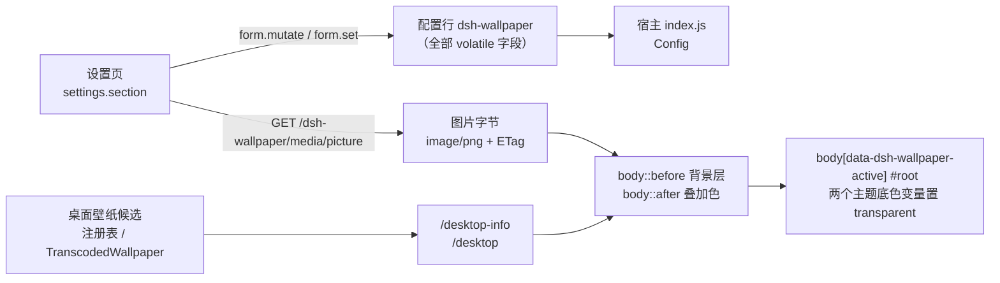

# DSH 壁纸背景插件（dsh-wallpaper）

把**本地图片**或**当前 Windows 桌面壁纸**铺在 DeepSeek Harness Web 界面的内容后面，并可调整透明度、缩放方式与叠加色。

| 项目 | 值 |
| --- | --- |
| 包名 | `@local/dsh-wallpaper` |
| 版本 | `0.1.0` |
| 插件类型 | DeepSeek Harness Web UI 插件（宿主 + 浏览器两端） |
| 许可证 | [MIT](LICENSE) |

> 本文所有功能描述均对应仓库内的 `index.js`、`client.js`、`package.json`、`cordis.patch.yml` 与 `locale/*.json` 的真实实现。

## 目录

- [功能特性](#功能特性)
- [工作原理](#工作原理)
- [Windows 桌面壁纸的读取方式](#windows-桌面壁纸的读取方式)
- [安装](#安装)
- [设置项](#设置项)
- [目录结构](#目录结构)
- [平台支持](#平台支持)
- [已知限制](#已知限制)
- [故障排查](#故障排查)
- [开发与验证](#开发与验证)
- [相关文档](#相关文档)
- [许可证](#许可证)
- [English](#english)

## 功能特性

- **三种背景来源**：`none`（关闭）、`picture`（本地图片）、`desktop`（跟随桌面壁纸）。
- **透明度可调**：`0`–`100`，`0` 时不绘制背景层；实际 CSS 透明度为 `opacity / 100`。
- **两种缩放方式**：`cover`（填满窗口，可能裁切）、`contain`（完整显示整张图）。
- **三种叠加色**：`none`、`dark`（`rgba(0, 0, 0, 0.38)` 压暗）、`light`（`rgba(255, 255, 255, 0.38)` 提亮）。
- **桌面壁纸自动跟随**：检测间隔 `0`–`3600` 秒，`0` 表示不再自动检查；壁纸身份变化时才重新绘制。
- **图片在浏览器端转 PNG**：选择文件后经 `createImageBitmap` + `canvas.toDataURL('image/png')` 处理，像素总量上限 **16M 像素**（`16 * 1024 * 1024`），超出则等比缩小。
- **单图上限 64 MB**：浏览器选择文件时按 `file.size` 校验；宿主读取桌面壁纸文件时以同一常量 `MAX_PICTURE_BYTES`（64 MB）过滤候选。
- **支持格式**：PNG、JPEG、WebP、GIF（浏览器端按 `/\.(png|jpe?g|webp|gif)$/i` 校验；宿主按扩展名映射媒体类型）。
- **缓存友好**：媒体路由带 ETag，命中 `If-None-Match` 时返回 `304`；图片路由使用 `cache-control: private, max-age=600`。
- **失败自动回退**：客户端会探测图片 URL 是否真的能加载，加载失败则移除背景层。
- **不破坏界面可读性**：仅在背景真正显示时把 `#root` 的两个主题底色变量置为透明，输入框、气泡、菜单、设置面板仍使用各自的表面色。
- **设置页实时预览**：设置页内含预览框，选择图片或切换桌面壁纸后可即时查看效果。
- **中英双语**：`locale/zh.json`、`locale/en.json` 提供插件标题与描述，`client.js` 内置完整的中英文界面词典。

## 工作原理

插件分为两半：**宿主半边**（`index.js`，Node 侧）负责持久化配置并提供媒体字节；**浏览器半边**（`client.js`）负责设置页与页面背景层。



### 宿主半边（`index.js`）

- 用 `@deepseek-ai/schemastery` 导出 `Config`，**每个字段都声明为 `volatile`**，由宿主设置服务投影到浏览器可编辑的表单 `ctx.configForms.get('dsh-wallpaper')`。
- 通过 `ctx.inject(['webServer'], child => child.effect(() => child.webServer.register({ path, handler }), label))` 在 Web 源上注册三条路由：

| 路由 | 作用 | 失败响应 |
| --- | --- | --- |
| `GET /dsh-wallpaper/media/picture` | 把配置行 `pictureData` 的 base64 解码后以 `image/png` 返回 | `404 {"error":"no-picture"}` |
| `GET /dsh-wallpaper/media/desktop-info` | 返回当前桌面壁纸的身份（`path`、`name`、`size`、`modifiedAt`、`digest`、`style`、`tile`、`url`） | 始终 `200`，非成功时为 `{ status, reason, platform }` |
| `GET /dsh-wallpaper/media/desktop` | 返回当前桌面壁纸的图片字节 | `404 {"error":reason}`，文件读取失败时附 `path` |

- 图片路由的 ETag 为 `sha256(字节) + "-" + pictureVersion`，桌面壁纸路由的 ETag 为壁纸 `digest`；两者都支持 `304` 协商缓存，并带 `x-content-type-options: nosniff`。

### 浏览器半边（`client.js`）

- 入口是 `window.__ModuleLoader__.load({ id: '@local/dsh-wallpaper', factory })`，工厂返回 `{ inject: ['locale', 'configForms', 'slots'], apply }`。
- `apply` 中依次完成：注册 `wallpaper` 词典（`ctx.locale.register('wallpaper', { zh, en })`）→ 注入样式表（`<style data-plugin-css="dsh-wallpaper-styles">`）→ 取得 `ctx.configForms.get('dsh-wallpaper')` 表单控制器 → 通过 `ctx.slots.inject('settings.section', ...)` 注册设置页（`id: 'wallpaper'`、`order: 40`）。
- 背景层是 `body` 的两个伪元素：`::before` 绘制背景图，`::after` 绘制叠加色；两者均为 `position: fixed`、`inset: 0`、`z-index: 0`、`pointer-events: none`，因此不拦截交互。
- `body[data-dsh-wallpaper-layer] #root` 被抬到 `position: relative; z-index: 1`；只有背景可见时，`body[data-dsh-wallpaper-active] #root` 才把 `--dsw-alias-bg-base` 与 `--dsw-specific-sidebar-fill` 置为 `transparent`。
- 关闭壁纸、没有可用来源或 `opacity === 0` 时，直接移除两个 `data-*` 标记并清空 `--dwp-*` 变量，界面立即恢复原主题底色。
- 设置页通过 `React.useSyncExternalStore` 订阅配置快照；`subscribe` 与 `getSnapshot` 均经 `React.useCallback` 包装，以保留 `ConfigFormController` 的 `this` 上下文。写单个字段用 `form.set(field, value)`，写多个字段用 `form.mutate` 一次原子提交。
- 选图时一次性写入 `pictureData`、`pictureFileName`、`pictureVersion`（`Date.now().toString(36)` + 内容摘要）与 `mode: 'picture'`。
- 桌面轮询是 `setTimeout` 链：来源为 `desktop` 且 `pollSeconds > 0` 时按该间隔轮询；其余情况每 5 秒重新读取一次配置，以便切换来源后能及时恢复轮询。
- 设置页自身在 `mode === 'desktop'` 时也会按 `pollSeconds` 刷新「当前桌面壁纸」提示与预览。

## Windows 桌面壁纸的读取方式

`desktop` 模式只在 Windows 上可用，候选来源按以下**优先级依次尝试，第一个存在且可服务的胜出**：

1. `HKCU\Control Panel\Desktop` 的 `Wallpaper` 值（用户设置的壁纸文件路径）。
2. `HKCU\Software\Microsoft\Windows\CurrentVersion\Explorer\Wallpapers` 的 `TranscodedImageCache`：从字节偏移 24 起按 UTF-16 解码，截断到第一个 `NUL`，得到转码后的图片路径。
3. `%APPDATA%\Microsoft\Windows\Themes\TranscodedWallpaper`。

同时会读取 `HKCU\Control Panel\Desktop` 的 `WallpaperStyle` 与 `TileWallpaper`。注册表通过 `powershell.exe -NoProfile -NonInteractive -ExecutionPolicy Bypass -EncodedCommand` 读取，超时 8 秒且 `windowsHide`。

壁纸身份 `digest` 由以下五项拼接后取 SHA-256：

```text
<candidate>|<size>|<mtimeMs>|<WallpaperStyle>|<TileWallpaper>
```

因此**替换同名壁纸文件**（大小或修改时间变化）或**改变填充/平铺方式**都会被识别为新壁纸，客户端随后重新拉取图片。扩展名不受支持、不存在、不是普通文件、大小为 0 或超过 64 MB 的候选会被跳过；全部候选都不可用时返回 `{"status":"error","reason":"no-wallpaper"}`。

## 安装

`package.json` 中 `private: true`，因此本插件**不通过 npm registry 分发**，安装方式是把仓库目录放进 Harness profile 的插件目录，并在 profile 的 `cordis.patch.yml` 中注册条目。**没有构建步骤，也不需要 `npm install`**：`dsh.client.inject` 声明的三个包由 Harness 自身提供。

文中约定：

- `<插件目录>`：Harness profile 的插件目录（profile 配置位于 `%USERPROFILE%\.dsh\profiles\<profile>\cordis.patch.yml`，文档记录的验证环境 profile 名为 `desktop`）。
- 仓库根目录即插件包根目录，`package.json` 的 `name` 必须保持为 `@local/dsh-wallpaper`。

### 方式一：把仓库文件复制到插件目录

```pwsh
# 在仓库根目录（wallpaper-plugin）中执行；-Force 保证 .gitignore 等点文件也被复制
$pluginRoot = "<插件目录>\dsh-wallpaper"
New-Item -ItemType Directory -Force -Path $pluginRoot | Out-Null
Get-ChildItem -LiteralPath . -Force | Where-Object { $_.Name -ne '.git' } |
  Copy-Item -Destination $pluginRoot -Recurse -Force
```

### 方式二：git clone 到插件目录

```pwsh
git clone https://github.com/phf0313/dsh-wallpaper-auto.git "<插件目录>\dsh-wallpaper"
```

### 方式三：在 `cordis.patch.yml` 中注册条目

把下面的片段合并进 profile 的 `cordis.patch.yml`：

```yaml
- insert:
    - id: dsh-wallpaper
      name: '@local/dsh-wallpaper'
      config: {}
```

- `id` 必须为 `dsh-wallpaper`：它就是客户端读取的配置命名空间（`client.js` 中的 `NS`），也是设置表单的绑定键。
- `name` 必须与 `package.json` 的 `name` 一致。
- `config: {}` 表示全部使用默认值（`mode: none`）。

> 仓库自带的 `cordis.patch.yml` 内容与上面完全一致，并由 `package.json` 的 `dsh.bundle.patch: "./cordis.patch.yml"` 指向；如果你的安装流程会读取包内的 patch，就无需手写这段。

### 验证安装

```pwsh
# 应输出 "name": "@local/dsh-wallpaper" 与 "version": "0.1.0"
Select-String -Path "<插件目录>\dsh-wallpaper\package.json" -Pattern '"name"|"version"'

# 注册条目应存在
Select-String -Path "$env:USERPROFILE\.dsh\profiles\<profile>\cordis.patch.yml" -Pattern 'dsh-wallpaper'
```

重启 Harness 后打开 **设置 → 壁纸背景**，能看到「背景来源 / 透明度 / 缩放方式 / 叠加色 / 图片 / 桌面壁纸检测间隔」即可认为安装成功。

## 设置项

配置行 `dsh-wallpaper` 的全部字段（定义见 `index.js` 的 `Config`，均带 `.volatile()`）：

| 字段 | 含义 | 取值 | 默认值 |
| --- | --- | --- | --- |
| `mode` | 背景来源 | `none` / `picture` / `desktop` | `none` |
| `opacity` | 透明度百分比，`100` 为完全不透明绘制 | 整数 `0`–`100` | `35` |
| `fit` | 缩放方式 | `cover`（填满窗口）/ `contain`（完整显示） | `cover` |
| `veil` | 叠加色 | `none` / `dark` / `light` | `none` |
| `pictureData` | 所选图片的 base64 字节，宿主解码后经媒体路由下发 | base64 字符串 | `""` |
| `pictureFileName` | 所选图片文件名，仅用于设置页展示 | 字符串 | `""` |
| `pictureVersion` | 换图时重写的缓存标记，参与图片路由的 ETag | 字符串 | `""` |
| `pollSeconds` | 桌面壁纸检测间隔（秒），`0` 表示不再自动检查 | 整数 `0`–`3600` | `300` |

补充说明：

- `veil` 的实际颜色：`dark` → `rgba(0, 0, 0, 0.38)`，`light` → `rgba(255, 255, 255, 0.38)`，`none` → `transparent`。
- 设置页的「恢复默认」只重置 `mode`、`opacity`、`fit`、`veil`、`pollSeconds`（回到 `none / 35 / cover / none / 300`），不会清除已选图片；清除图片请用「移除图片」（同时把 `mode` 置回 `none`）。
- 设置页控件是否可编辑取决于表单快照的 `writable`：为 `false` 时下拉框、滑块、数字输入框与图片/重置按钮均禁用（`mode === 'desktop'` 时出现的「立即检查」按钮不受此限制）。
- 切换背景来源、调整透明度/缩放/叠加色都会立即重绘背景层，无需重启。

## 目录结构

```text
wallpaper-plugin/                 # 仓库根，同时是插件包根
├─ index.js                       # 宿主半边：Config 模型 + 三条媒体路由 + Windows 壁纸读取
├─ client.js                      # 浏览器半边：设置页、样式注入、背景层与桌面轮询
├─ package.json                   # 包清单：name / exports / files / dsh.bundle / dsh.client
├─ cordis.patch.yml               # 插入 dsh-wallpaper 条目的 patch
├─ icon.svg                       # 插件图标
├─ locale/
│  ├─ zh.json                     # 中文 meta（标题、描述）
│  └─ en.json                     # 英文 meta（标题、描述）
├─ docs/
│  ├─ 壁纸背景插件启动故障修复/说明.md
│  └─ 主界面壁纸显示修复/说明.md
├─ README.md
├─ LICENSE
├─ .gitignore
└─ .gitattributes
```

`package.json` 的关键字段：

- `type: "module"`：宿主半边是原生 ESM。
- `exports`：`.` → `./index.js`，`./client` → `./client.js`，`./locale/*.json`、`./icon` → `./icon.svg`。
- `files`：仅打包运行时必需文件（`index.js`、`client.js`、`cordis.patch.yml`、`locale/*.json`、`icon.svg`），因此请直接使用整个仓库目录安装。
- `dsh.bundle.patch`：`./cordis.patch.yml`。
- `dsh.client`：`platform: "web"`、`immediately: true`，`inject` 声明 `@deepseek-ai/dsh-client-locale`、`@deepseek-ai/dsh-client-ui-settings`、`@deepseek-ai/dsh-client-ui-layout`。
- `license: "MIT"`、`author: "phf0313"`，`repository` / `homepage` / `bugs` 均指向 `https://github.com/phf0313/dsh-wallpaper-auto`。

## 平台支持

| 能力 | 平台 | 说明 |
| --- | --- | --- |
| 本地图片背景 | 跨平台 | 依赖浏览器 `createImageBitmap` 与 `canvas` 转码，宿主只负责下发字节 |
| 跟随桌面壁纸 | **仅 Windows** | `process.platform !== 'win32'` 时 `/desktop-info` 返回 `{"status":"error","reason":"unsupported-platform","platform":"..."}`，`/desktop` 返回 `404`，设置页显示「当前系统没有可读取的桌面壁纸」 |
| 注册表读取 | **仅 Windows** | 依赖系统自带 `powershell.exe` |

文档记录的验证环境为 Windows 版 DeepSeek Harness（启动故障修复记录中提到的版本为 `0.2.1-rc.3`）。

## 已知限制

- **图片以 base64 存进配置行**：`pictureData` 会随配置一起写入 profile 的 `cordis.patch.yml`，图片越大，配置体积越大。
- **只在浏览器端限制像素总量**：转换只按「≤ 16M 像素」等比缩小，并以无损 PNG 编码，没有质量参数；部分大图转 PNG 后体积仍可能偏大。
- **未做端到端大图测试**：本地图片选择器上传与大图片存储尚未完成完整端到端验证（见 [启动故障修复说明](<docs/壁纸背景插件启动故障修复/说明.md>)）。
- **未做换壁纸联动实测**：更换系统壁纸后等待一个检测周期（默认 300 秒）的联动效果尚未实测。
- **只读当前用户、单个壁纸路径**：仅读取 `HKCU` 下当前用户的壁纸设置，不区分多显示器各自的壁纸。
- **依赖 PowerShell**：若 `powershell.exe` 被策略禁用或无法执行，候选路径为空，会得到 `no-wallpaper`。
- **图片路由固定返回 `image/png`**：因为浏览器端已把任意受支持格式统一转成 PNG。

## 故障排查

三类典型问题都有独立的修复记录，详见 [相关文档](#相关文档)。

### 1. 启动崩溃 / 提示「1 entry did not activate」

- 现象：启动日志出现 `@local/dsh-wallpaper: loading` 后条目未激活。
- 原因：客户端直接使用了 `locale`、`configForms`、`slots` 服务，但既没有在导出对象里声明 `inject`，`package.json` 也没有声明客户端包依赖。
- 处理：`client.js` 必须返回 `{ inject: ['locale', 'configForms', 'slots'], apply }`，同时 `package.json` 的 `dsh.client.inject` 要列出 locale、ui-settings、ui-layout 三个包名。

### 2. 设置页空白

- 现象：能进入「壁纸背景」页，但正文不渲染。
- 原因：`ConfigFormController.subscribe()` 与 `getSnapshot()` 依赖 `this.store`，直接传给 `React.useSyncExternalStore` 会丢失实例上下文。
- 处理：用 `React.useCallback` 包装这两个方法后再订阅，既保留 `this` 又保持引用稳定。

### 3. 主界面不显示壁纸（只有设置页预览能看到）

- 现象：关闭设置后主界面仍是纯色背景。
- 原因：已安装版本的 AppFrame 主框架、中央列与 Sidebar 用 `--dsw-alias-bg-base` 和 `--dsw-specific-sidebar-fill` 绘制不透明底色，而壁纸伪元素位于应用根节点下方，被这些表面遮挡。
- 处理：仅在 `body[data-dsh-wallpaper-active] #root` 范围内把上述两个变量置为 `transparent`；关闭壁纸或 `opacity` 为 `0` 时移除激活标记，主题底色自动恢复。不要用隐藏整个 `#root` 的方式做预览。

### 通用自查

1. 浏览器开发者工具 Network 中确认 `GET /dsh-wallpaper/media/desktop-info` 返回 `status: "ok"`；若为 `unsupported-platform` 说明不在 Windows 上，`no-wallpaper` 说明候选路径都不可用。
2. 确认当前 `mode` 为期望的来源，且 `opacity > 0`（`0` 时不绘制背景层）。
3. 确认配置行确实写入：查看 profile 的 `cordis.patch.yml` 中 `dsh-wallpaper.config` 是否含期望值。
4. 修改 `client.js` / `index.js` 后需要**重启 Harness** 才生效。

## 开发与验证

- **无构建步骤**：没有打包器、没有编译产物。宿主半边是原生 ESM（`type: "module"`），浏览器半边是 `__ModuleLoader__` 工厂模块。
- **语法检查**（`node --check` 只校验语法，不会执行浏览器端代码）：

```pwsh
node --check index.js
node --check client.js
```

- **手工验收清单**：

```text
[ ] 冷启动进入主界面，无启动崩溃日志
[ ] 设置 → 壁纸背景 正常渲染全部控件
[ ] 选择本地图片后，背景出现在主界面且预览一致
[ ] 透明度 0 / 100 边界表现正确
[ ] cover 与 contain 表现不同且符合预期
[ ] dark / light 叠加色生效
[ ] desktop 模式下显示当前桌面壁纸文件名
[ ] 更换系统壁纸后，一个检测周期内自动跟随（pollSeconds 设为较小值验证）
[ ] 切回 none 后界面恢复原主题底色
[ ] 移除图片后配置行中 pictureData 为空
```

- 代码风格：`client.js` 与 `index.js` 使用 2 空格缩进、单引号、无分号；注释与界面文案均保持中英对应。

## 相关文档

- [壁纸背景插件启动故障修复](<docs/壁纸背景插件启动故障修复/说明.md>)：启动崩溃与设置页空白的根因、修改与验证记录。
- [主界面壁纸显示修复](<docs/主界面壁纸显示修复/说明.md>)：主界面不显示壁纸的根因、主题变量覆盖方案与验证记录。

## 许可证

[MIT](LICENSE) © 2026 phf0313

## English

**dsh-wallpaper** is a DeepSeek Harness Web UI plugin that paints a picture or the current Windows desktop wallpaper behind the whole interface, with adjustable opacity, scaling, and an overlay shade.

- **Background source**: `none`, a picked `picture`, or the live `desktop` wallpaper (Windows only).
- **Opacity** `0`–`100`, **scaling** `cover` / `contain`, **overlay** `none` / `dark` / `light`.
- **Desktop follow**: the host reads the wallpaper path from `HKCU\Control Panel\Desktop`, falls back to `TranscodedImageCache` and `%APPDATA%\Microsoft\Windows\Themes\TranscodedWallpaper`, and hashes path + size + mtime + `WallpaperStyle` + `TileWallpaper` into a digest. The browser polls `/dsh-wallpaper/media/desktop-info` at the configured interval (`0` disables polling).
- **Pictures** are re-encoded to PNG in the browser, capped at 16M pixels and 64 MB per file, then served by the host at `/dsh-wallpaper/media/picture`.
- **Painting** happens in `body::before` (image) and `body::after` (shade); only while the layer is active are `--dsw-alias-bg-base` and `--dsw-specific-sidebar-fill` set to `transparent` inside `#root`.
- **Install**: copy or `git clone` this repository into your Harness profile plugin directory and register the entry in `cordis.patch.yml` as `id: dsh-wallpaper`, `name: '@local/dsh-wallpaper'`. No build step and no `npm install` are required.
- **Requires**: DeepSeek Harness Web UI (validated on `0.2.1-rc.3`). Desktop-wallpaper following requires Windows.

Licensed under the [MIT License](LICENSE).
